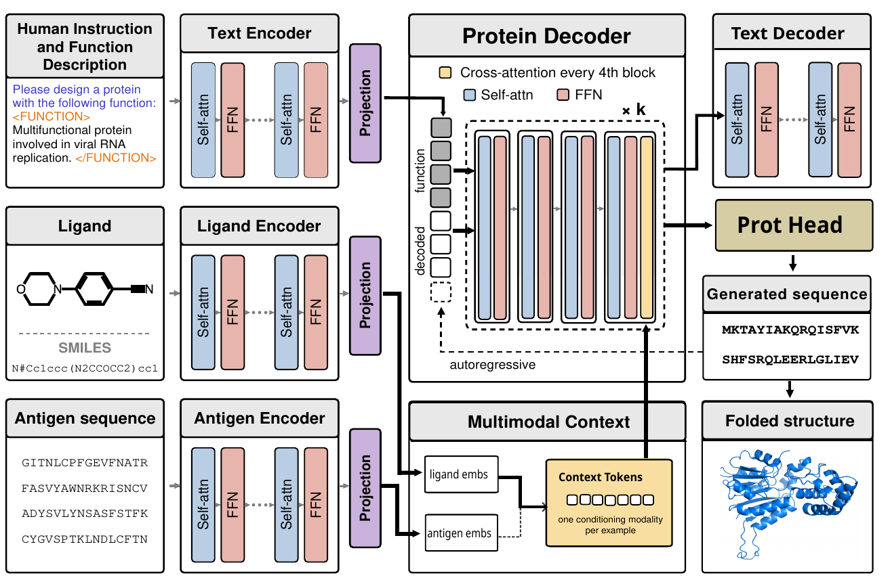

<div align="center">

# InstructPro2

### Natural Language and Biological Grounding<br/>Guided De Novo Protein Design

<p>
<a href="https://arxiv.org/abs/2610.19592"></a>
<a href="https://huggingface.co/charlesnovak/InstructPro2"></a>
<a href="https://huggingface.co/datasets/charlesnovak/InstructPro2Bench"></a>


</p>



</div>

<hr />

**InstructPro2** designs proteins from natural-language function descriptions. A
text encoder reads the instruction, frozen ligand (ChemBERTa) and antigen
(ESM-2) encoders supply biological context through zero-initialized gated
cross-attention adapters, and a protein decoder initialized from
ProGen2-large-BFD90 generates the sequence.

- **Two-stage training** — instruction-following pretraining on InstructPro2Bench, then finetuning with biological grounding.
- **Two downstream tasks** — ligand-binding protein design and antibody HCDR design.
- **3.2B parameters** — built on a fairseq fork; the InstructPro2 code lives inside `fairseq/`.

## ⚒️ Installation

```bash
git clone [https://github.com/chovak/InstructPro2.git](https://github.com/chovak/InstructPro2.git)
cd InstructPro2

conda env create -f protein.yml    # creates the `InstructPro2` environment
conda activate InstructPro2
bash setup.sh                      # builds the Cython extensions, installs the package
```

The evaluation pipeline additionally needs `pymol`, `biopython`, and a
`transformers` install with ESMFold available.

## 💿 Weights and Data

Weights and datasets are hosted on the Hugging Face Hub. `WORK_ROOT` is the
root for data, models, and output, and every script reads it; set it once and
the defaults follow.

```bash
export WORK_ROOT=/path/to/workspace    # default: ~/instructpro2

huggingface-cli download charlesnovak/InstructPro2 --local-dir $WORK_ROOT/model
huggingface-cli download charlesnovak/InstructPro2Bench --repo-type dataset --local-dir $WORK_ROOT/data
```

Downloading `charlesnovak/InstructPro2` populates `$WORK_ROOT/model` with the
Stage 1 and Stage 2 checkpoints (`instructpro2_*.pt`) along with
`progen2/progen2-large-BFD90/` for decoder initialization.

Downloading `charlesnovak/InstructPro2Bench` gives `$WORK_ROOT/data/stage1`,
`$WORK_ROOT/data/ligand`, and `$WORK_ROOT/data/antibody`, which is where the
scripts look by default. Each directory holds the splits the scripts name with
`--valid-subset`:

| Stage | Directory | Splits |
|---|---|---|
| Stage 1 pretraining | `stage1/` | `train`, `valid`, `test` |
| Stage 2 ligand | `ligand/` | `train`, `valid`, `test_ligand`, `test_ligand_unseen` |
| Stage 2 antibody | `antibody/` | `train`, `valid`, `final_antibody_test` |

`--dataset-impl` selects the reader: `instructpro2` for Stage 1,
`instructpro2_ligand` and `instructpro2_antibody` for the Stage 2 tasks.

Each split is a JSONL file. Every line carries `tokenized_instruction`
(PubMedBERT token ids) and the target protein as an amino-acid string, which
may contain `<SEP>` and `<M1>`–`<M30>` for infilling targets. The Stage 1
splits name that field `output` and the Stage 2 splits name it
`target_protein`; the reader accepts either. `ligand` (SMILES strings) and
`antigen` (chain sequences) are present for the Stage 2 tasks.

## 🔬 Running

Every script is configured by environment variables with defaults; override
what you need rather than editing the files.

### Step 1: Stage 1 pretraining

To pretrain the model on the Stage 1 dataset, use `train_stage1.sh`:

```bash
sbatch train_stage1.sh    # or: bash train_stage1.sh
```

Generate and inspect Stage 1 designs:

```bash
MODEL_CHECKPOINT=$WORK_ROOT/model/instructpro2_stage1.pt bash validate_stage1.sh
```

### Step 2: Stage 2 finetuning

Both start from a Stage 1 checkpoint:

```bash
STAGE1_CHECKPOINT=$WORK_ROOT/model/instructpro2_stage1.pt bash train_stage2_ligand.sh
STAGE1_CHECKPOINT=$WORK_ROOT/model/instructpro2_stage1.pt bash train_stage2_antibody.sh
```

### Step 3: Evaluation

Each pipeline generates sequences, folds them with ESMFold, and scores them
against ground-truth structures:

```bash
MODEL_CHECKPOINT=$WORK_ROOT/model/instructpro2_stage2_ligand.pt   bash eval_ligand.sh
MODEL_CHECKPOINT=$WORK_ROOT/model/instructpro2_stage2_antibody.pt bash eval_antibody.sh
```

> [!TIP]
> Both evaluations run twice by default: once with the modality encoder active
> (`w_modality`) and once without (`no_modality`), which is the ablation
> reported in the paper. Set `MODES=w_modality` to run only the first.

## ⚙️ Architecture Modes

`--architecture-mode` selects which components are trainable:

| Mode | Use |
|---|---|
| `stage1` | Pretraining — text conditioning only, no modality encoders. |
| `stage2` | The biological grounding stage reported in the paper. |
| `stage2_frozen_decoder`, `stage2_partial`, `stage2_adapters_only` | Ablations. |

## 📁 Where the Code Lives

This repository is a fork of [fairseq](https://github.com/facebookresearch/fairseq);
the InstructPro2 code lives inside the `fairseq/` package.

| File | What it does |
|---|---|
| `fairseq/models/language_guided_protein_design_model.py` | The model: text encoder, gated cross-attention adapters, protein decoder |
| `fairseq/tasks/language_guided_protein_design_task.py` | Builds the model, loads datasets, runs generation during validation |
| `fairseq/criterions/instructpro2_loss.py` | Training objective, `L = L_protein + 0.5 * L_text`, including the prefix loss mask for infilling |
| `fairseq/data/instructpro2_dataset.py` | Batches examples, pads each input stream with its own encoder's pad token |
| `fairseq/data/indexed_dataset.py` | Readers for the Stage 1, ligand, and antibody datasets |
| `fairseq/models/progen_vocab.py` | Amino-acid alphabet, including `<SEP>` and `<M1>`–`<M30>` for span infilling |
| `eval/` | Folding and structural scoring: ESMFold, PyMOL RMSD, HCDR recovery |
| `scripts/` | Release utilities: checkpoint stripping, dataset sampling |

## ✍️ Citation

If you find InstructPro2 useful in your research, please cite our work:

```bibtex
@article{instructpro2,
  title   = {InstructPro2: Natural Language and Biological Grounding Guided De Novo Protein Design},
  author  = {Charles Novak and Zhenqiao Song and Chuan Li and Jianwen Xie and Lei Li},
  journal = {arXiv preprint arXiv:2610.19592},
  year    = {2026}
}
```

## 🪪 License

This project is licensed under the terms specified in the [LICENSE](LICENSE) file.

## 💫 Contributions

Contributions are welcome — open an issue or pull request to get involved.

Contact: [Charles Novak](mailto:cnovak2@andrew.cmu.edu)
